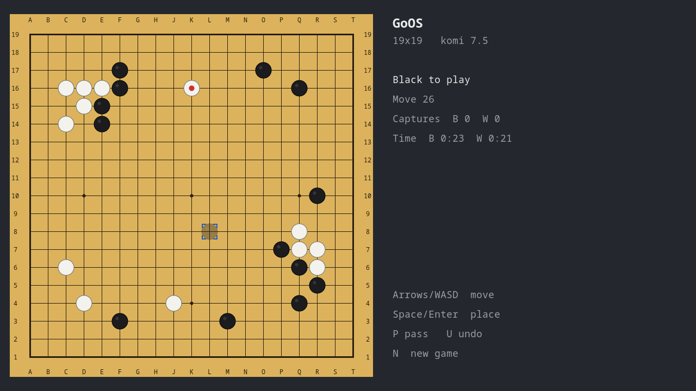
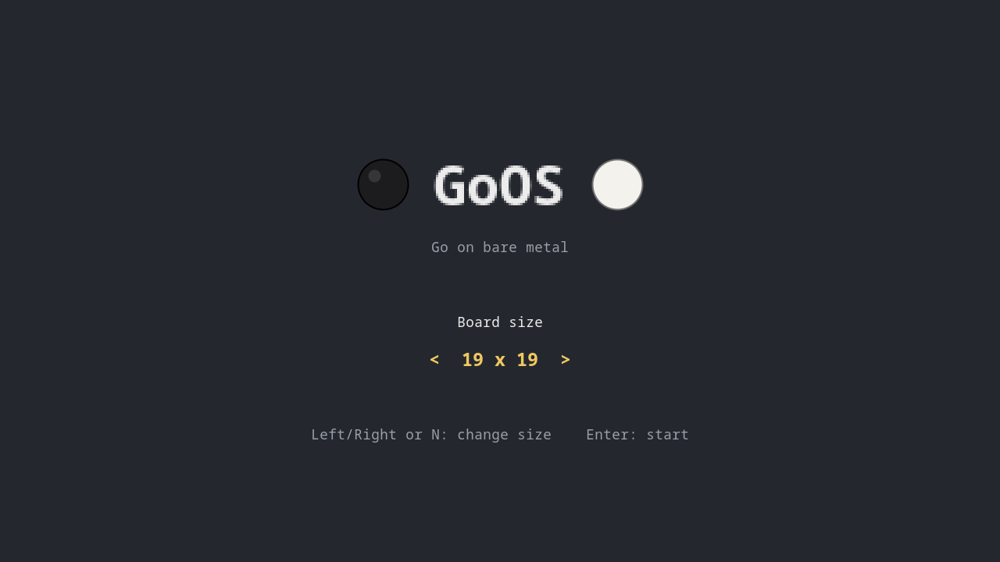
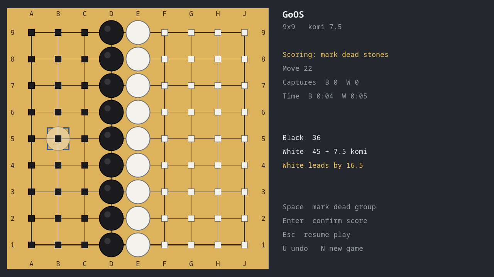

# GoOS

A small x86_64 kernel written in Rust that boots straight into a game of
[Go](https://en.wikipedia.org/wiki/Go_(game)). There is no operating system
underneath: the kernel sets up its own interrupts, reads the PS/2 keyboard,
draws on the framebuffer and runs the game. Two players share one keyboard
(hotseat) on a 9×9, 13×13 or 19×19 board, with full rules and area scoring.



| Start screen | Scoring a finished 9×9 game |
|---|---|
|  |  |

## Setup

You need Rust (via [rustup](https://rustup.rs)) and QEMU.

**Rust.** The repository pins a nightly toolchain in `rust-toolchain.toml`,
and rustup installs it automatically (with `rust-src`, `llvm-tools` and the
`x86_64-unknown-none` and `x86_64-unknown-uefi` targets) the first time you
build, or when you run `rustup show` in the repository. To install it by
hand:

```sh
rustup toolchain install nightly-2026-11-10 \
    --component rust-src,llvm-tools,rustfmt,clippy \
    --target x86_64-unknown-none,x86_64-unknown-uefi
```

**QEMU.** On Arch Linux:

```sh
sudo pacman -S qemu-system-x86 qemu-ui-gtk qemu-audio-pipewire
```

This also installs SeaBIOS and the OVMF UEFI firmware. On other
distributions:

- Debian/Ubuntu: `sudo apt install qemu-system-x86 qemu-system-gui ovmf`
- Fedora: `sudo dnf install qemu-system-x86-core qemu-ui-gtk qemu-audio-pipewire edk2-ovmf`

UEFI boot looks for the OVMF firmware in the usual places; if it isn't
found, point `GOOS_OVMF` at your `OVMF.fd`.

## Run

```sh
cargo run --release            # build the disk image and boot it (BIOS)
cargo run --release -- uefi    # boot the UEFI image instead
cargo run --release -- images  # print where the disk images are
cargo test -p go-core          # run the rules tests on the host
```

The first build takes a while: the `bootloader` crate downloads and builds
its own boot stages. Serial output (`serial_println!`) appears in the
terminal; moves are logged there too.

Environment variables for the runner:

| Variable | Effect |
|---|---|
| `GOOS_AUDIO=pipewire\|pa\|none` | Force an audio backend for the PC speaker. By default PipeWire or PulseAudio is used if available, otherwise sound is off. |
| `GOOS_DEBUG=1` | Use software emulation and log interrupts and CPU resets to `qemu.log`; the VM pauses instead of rebooting on a triple fault. |
| `GOOS_OVMF=<path>` | UEFI firmware image to use with `uefi`. |
| `GOOS_HEADLESS=1` | No window; the QEMU monitor listens on a Unix socket (`GOOS_MONITOR`, default `target/goos-monitor.sock`) for scripted testing with `sendkey` and `screendump`. |

## How to play

| Key | Action |
|---|---|
| ← → / ↑ ↓ (or N) on the start screen | choose board size 9 → 13 → 19 |
| Enter / Space | start the game |
| Arrow keys / WASD | move the cursor |
| Space / Enter | place a stone |
| P | pass |
| U | undo |
| N | back to the start screen (Esc returns to the current game) |

After both players pass in a row, the game enters **scoring mode**:

| Key | Action |
|---|---|
| Space | mark or unmark the group under the cursor as dead |
| Enter | confirm the score and end the game |
| Esc | resume play |
| U | undo the last pass (after confirming: back to scoring) |

Dead stones are drawn faded. Small squares show whose territory each point
is, and the panel shows the live score.

**Rules:** Chinese area scoring (stones on the board plus surrounded empty
points), komi 7.5, suicide is illegal and **positional superko**: no move may
recreate an earlier board position (the last 1024 positions are remembered).
Illegal moves are shown in the status panel ("Occupied", "Suicide", "Ko",
"Superko") with a low buzz.

**Clocks:** the panel shows each player's thinking time. Only the clock of
the player to move runs, and only during play (not on the start screen or
while scoring). Clocks restart with a new game; undo doesn't give time back.

**Sound:** placing a stone clicks on the PC speaker, a capture plays a lower,
longer tone and an illegal move a 220 Hz buzz. Without an audio backend QEMU
simply runs silently.

## How it works

```
.
├── go-core/   the rules: #![no_std], no allocation, unit-tested on the host
├── kernel/    the bare-metal kernel (target x86_64-unknown-none)
└── runner/    host program: builds the disk images and launches QEMU
```

- **Booting.** The [`bootloader`](https://github.com/rust-osdev/bootloader)
  crate (0.11) loads the kernel ELF, switches to 64-bit mode, sets up a linear
  framebuffer and calls `kernel_main`. `runner/build.rs` depends on the kernel
  as a cargo *artifact dependency* (built for `x86_64-unknown-none`) and turns
  it into BIOS and UEFI disk images; `runner/src/main.rs` starts QEMU on one.
- **CPU setup** (`gdt.rs`, `interrupts.rs`). A GDT with a TSS gives the
  double-fault handler its own stack, so even a stack overflow is reported
  instead of silently rebooting. The IDT handles breakpoints, double, page and
  general-protection faults. The two 8259 PICs are remapped to vectors 32–47.
- **Timer** (`pit.rs`). PIT channel 0 interrupts 1000 times a second and
  increments a tick counter, used for message timeouts, clocks and sounds.
- **Keyboard** (`input.rs`). The IRQ1 handler only reads the scancode and
  pushes it onto a lock-free ring buffer. The main loop decodes scancodes
  (including the extended ones for the arrow keys) with `pc-keyboard` and
  maps them to game actions. When there is nothing to do, the CPU sleeps with
  `hlt` until the next interrupt.
- **Drawing** (`framebuffer.rs`, `font.rs`, `ui.rs`). Primitives handle both
  RGB and BGR framebuffers and any stride. Stones and text are anti-aliased.
  To avoid flicker without a full back buffer, each board intersection (and
  each status line) is drawn into a small off-screen tile and copied to the
  screen in one pass, and only the intersections and lines whose content
  changed get redrawn (`app.rs`).
- **Rules** (`go-core`). A board is a fixed `[Cell; 19 * 19]`. Captures and
  liberties use a flood fill with fixed-size stacks. Positions are hashed with
  Zobrist keys generated at compile time by a `const fn` splitmix64, and the
  game keeps 1024 snapshots for undo and superko. Scoring removes the marked
  dead stones and flood-fills empty regions to find their owners.
- **Sound** (`sound.rs`). Tones are played on the PC speaker through PIT
  channel 2 and switched off by the main loop when their time is up, so
  nothing blocks.

## Running on real hardware (optional, untested)

The BIOS image is a plain raw disk image, so it can be written to a USB
stick. **This erases the whole stick.** Find the stick's device name with
`lsblk` and double-check it: use the whole disk (`/dev/sdX`), not a
partition (`/dev/sdX1`), and unmount any of its mounted partitions first.

```sh
cargo run --release -- images                     # shows the image paths
sudo umount /dev/sdX?*                            # if anything is mounted
sudo dd if=<path to bios.img> of=/dev/sdX bs=4M conv=fsync status=progress
```

Boot the machine from the stick in legacy BIOS (CSM) mode, or write
`uefi.img` instead for UEFI boot (Secure Boot must be off). GoOS needs a PS/2
keyboard or a firmware that emulates one for USB keyboards ("USB legacy
support"), and uses the PC speaker if the machine has one.

## Debugging

- `GOOS_DEBUG=1 cargo run --release` writes every interrupt and CPU reset to
  `qemu.log` and keeps the VM paused after a triple fault.
- Panics (including CPU exceptions) print a message and location on serial
  and halt.
